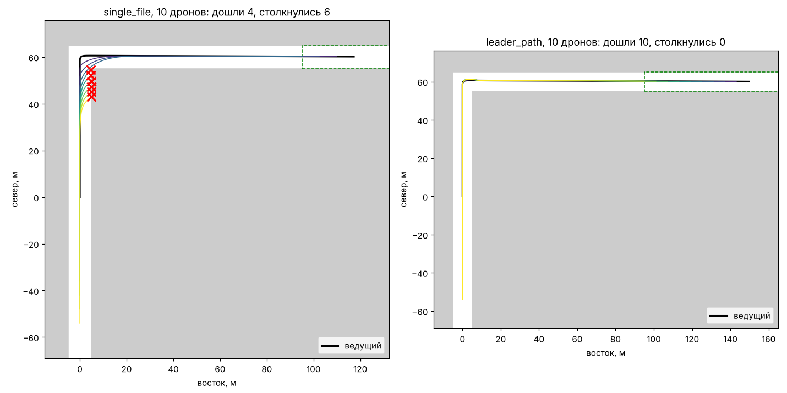

# MultiUAV — симулятор оператора роя

Оператор с настоящим пультом RadioMaster ведёт дрон по коридору в Unreal Engine 5.
Летит один дрон или лидер с группой ведомых. В некоторых местах коридора экран
оператора гаснет, как при помехе видеосигнала. Программа пишет лог: время,
координаты, столкновения и 4 канала пульта, а когнитивисты потом считают по нему
свои метрики вместе с данными своих датчиков.

Картинку и физику даёт [Cosys-AirSim](https://github.com/Cosys-Lab/Cosys-AirSim)
на Unreal Engine 5. Ведомыми управляют подключаемые алгоритмы на Python. Для отладки
без видеокарты есть упрощённый симулятор без графики (`kinematic`): в нём же
работают автоматические тесты.



Слева колонна из 10 дронов «гуськом»: каждый летит прямо на предыдущего, хвост
срезает угол и врезается в здание. Справа «по следу ведущего»: все проходят поворот
там же, где прошёл ведущий. Это нереалистично (ведомые знают весь путь лидера),
поэтому для эксперимента сделаны алгоритмы «по зрению», см. ниже.

## Экспериментальный стенд: развернуть на другом компьютере

Один дрон, Acro, трасса Виталия, меню «Эксперимент БПЛА». Полная пошаговая инструкция —
[docs/DEPLOY_STAND.md](docs/DEPLOY_STAND.md). Коротко:

1. Ubuntu 22.04 (сеанс Xorg), драйвер NVIDIA, Unreal Engine 5.8 в `~/Downloads/UnrealEngine5`,
   UBA отключён (`BuildConfiguration.xml`).
2. Скопировать с ноутбука проект `~/Desktop/New_Karta_Vitali` (без `Saved`, `Intermediate`,
   `DerivedDataCache`) и собрать:
   `~/Downloads/UnrealEngine5/Engine/Build/BatchFiles/Linux/Build.sh BlocksEditor Linux Development -Project="$HOME/Desktop/New_Karta_Vitali/Blocks.uproject"`.
3. Программа и **все модули Python в `.venv`** (пульт читает модуль `evdev` из `pip`,
   `apt install evtest` — другая программа):
   ```bash
   sudo apt install git python3-venv python3-tk python3-dev gcc
   git clone -b friday-trial https://github.com/Pseubonimb/multiuav_svetlakov.git ~/Documents/multiuav_svetlakov
   cd ~/Documents/multiuav_svetlakov && python3 -m venv .venv && .venv/bin/pip install -e ".[cosys,gamepad,sticks,plot,dev]"
   ```
4. Пульт виден без sudo: `.venv/bin/python -m multiuav sticks list` (нет — `sudo usermod -aG input $USER` и перезайти).
5. Один раз открыть карту в редакторе (компиляция шейдеров), `python -m multiuav track save`
   (эталон ворот), `scripts/install_launcher.sh` (значок), пробная попытка из меню.

## Быстрый старт без Unreal

```bash
python3 -m venv .venv && . .venv/bin/activate
pip install -e ".[cosys,gamepad,plot,dev]"
pytest -q
python -m multiuav compare scenarios/corner.yaml --algorithms visual_follow,flock --plot corner.png
```

`compare` прогоняет алгоритмы на группах из 3, 5, 7 и 10 дронов и печатает, сколько
дошло до финиша, сколько столкнулось и за какое время.

## Полёт в Unreal одной командой

Установка Unreal, Cosys-AirSim и все найденные проблемы на Ubuntu 22.04 —
в [docs/MultiUAV-Cosys-UE5_Ubuntu22_experience.md](docs/MultiUAV-Cosys-UE5_Ubuntu22_experience.md).
Для окна камер нужен патч плагина из [airsim_patches/](airsim_patches/README.md).

```bash
scripts/demo.sh                 # пульт в AltHold, 4 ведомых, карта Blocks
scripts/demo.sh -m acro         # пульт в Acro
scripts/demo.sh -f 0            # один дрон, без группы
scripts/demo.sh -k              # без 3D, в упрощённом симуляторе
scripts/demo.sh -h              # все опции
```

Скрипт пишет `settings.json` для нужного числа дронов, запускает карту в режиме игры
(без кнопки Play), ждёт симулятор, открывает экраны камер ведомых и запускает полёт.
Во время полёта: **L** в терминале — посадить ведомых / поднять обратно, **Ctrl+C** —
закончить. Лог и картинка траекторий — в `runs/demo_<время>/`.

## Модель дрона и сопротивление воздуха

Обычный дрон Cosys-AirSim тяжёлый (тяга/вес 1,7) и скользит, как по льду: в физике AirSim
нет сопротивления винтов. Обе вещи настраиваются в сценарии — **на верхнем уровне файла**,
рядом с `drones` (не внутри `leader:` или `params:` — там их молча пропустят):

```yaml
name: rc_group
model: fast2.5      # модель дрона
rotor_drag: 0.035   # сопротивление винтов, с/м
drones: 5
```

| `model` | Тяга/вес | Что это |
|---|---|---|
| `generic` (по умолчанию) | 1,7 | обычный дрон AirSim: поворот 90° на 15 м/с — 2,3 с, снос вперёд 17 м |
| `fast2.5` | 4,3 | тяга ×2,5: тот же поворот — 1,7 с, снос 9 м; рекомендуется для Acro |
| `fast<k>`, например `fast2`, `fast3` | 1,7·k | тяга ×k (от 1 до 4); `fast` без числа — ×1,3 |

| `rotor_drag` | Дрон на 15 м/с выровнялся — прокатился | Скорость на наклоне 60° |
|---|---|---|
| `0` (по умолчанию) | 145 м и не остановился — «лёд» | — |
| `0.02` | 55 м за 9 с | 28 м/с |
| `0.035` | 31 м за 5 с — как в упрощённом симуляторе `kinematic` | 23 м/с |
| `0.05` | 18 м за 3 с | 20 м/с |

Цифры — замеры на `fast2.5`; на `generic` с тем же `rotor_drag` дрон медленнее. Больше
`rotor_drag` — цепче и тормозит сам, но ниже предельная скорость.

**Один раз:** наложить на плагин патчи 01–04 и пересобрать — команды в
[airsim_patches/README.md](airsim_patches/README.md). Без них `model` и `rotor_drag`
молча игнорируются, и дрон летает как обычный. В готовой сборке игры (`Blocks.sh` с чужой
машины) патчей нет — её нужно собрать заново с пропатченным плагином.

**Поменять модель или сопротивление** — поправить сценарий и перезапустить Unreal: плагин
читает `settings.json` только при запуске (или при нажатии Play в редакторе).

```bash
scripts/demo.sh -f 0                            # сам пишет settings.json и перезапускает Unreal
scripts/demo.sh -s scenarios/rc_single.yaml -f 0   # другой сценарий: fast2.5 и rotor_drag 0.035
```

То же по шагам, без скрипта:

```bash
python -m multiuav settings scenarios/rc_group.yaml --followers 0 --write   # записать settings.json
grep -E '"Model"|RotorDrag' ~/Documents/AirSim/settings.json                # проверить, что ключи попали
ue5 "$HOME/Downloads/Blocks 5.8/Blocks.uproject"                            # затем Play (или перезапустить Play)
python -m multiuav run scenarios/rc_group.yaml --backend cosys --followers 0
```

С `scripts/demo.sh -e` (Unreal уже открыт) новые значения подхватятся только после
повторного нажатия Play. В `kinematic` (`-k`) `model` и `rotor_drag` не действуют: там своя
упрощённая модель, и сопротивление в ней есть всегда.

Для опытов есть ещё `rate_gains: {p: …, i: …, d: …}` — коэффициенты регулятора угловых
скоростей SimpleFlight. Не задавайте без нужды: плагин сам подбирает их под `fast<k>`, а
большие P (0,25–0,6 на `fast2.5`) дают перекрут и раскачку. Как это делалось и все
замеры — в [отчёте](docs/drone_physics_report.md); скрипты замеров — `scripts/physics_tests/`.

## Что уже умеет

- **Пульт RadioMaster** (EdgeTX, режим USB Joystick) или геймпад. Режимы:
  - **AltHold** — стики задают наклон, газ — скорость подъёма (середина — держать высоту);
  - **Acro** — стики задают скорость вращения, газ — тягу, горизонт никто не держит.

  Режим — `--mode`, или тумблер на пульте (`mode_switch` в сценарии). Каналы и режим
  видны поверх окна Unreal. Номера осей пульта: `python -m multiuav gamepad`.
- **Группа за лидером:** `--followers N`. Ведомые не опускаются ниже 3 м и садятся по клавише L.
- **Ведомые без связи друг с другом** (`visual_follow`, `flock`): каждый видит только тех
  соседей, кого заметили бы его камеры (дальность, поле зрения, заслонение стеной,
  ошибка оценки), а стены — своим круговым лидаром. Угол `corner.yaml` в `kinematic`
  проходят группы до 10 дронов без столкновений; в Unreal у углов изредка задевают стены.
- **Экраны камер ведомых** поверх окна игры, с подсветкой столкновений:
  `python -m multiuav cameras --followers N`. Или до трёх встроенных подокон AirSim
  (`scripts/demo.sh -w -n`).
- **Столкновения** видны в окне Unreal (красная строка и надпись над дроном) и пишутся в лог.
- **Лог** `track.csv`: время, номер дрона, координаты, высота, курс, столкновение,
  4 канала пульта и режим, 20 строк в секунду на дрон. Сводка — `summary.json`.
- **Быстрая модель дрона и сопротивление винтов** — `model: fast2.5`, `rotor_drag: 0.035`
  в сценарии, см. [выше](#модель-дрона-и-сопротивление-воздуха).
- Реалистичная карта реального мира через Cesium for Unreal (`-M cesium`) — для полётов
  на высоте от 50 м; вблизи геометрия грубая.

## Команды

| Команда | Что делает |
| --- | --- |
| `run <сценарий>` | один полёт: `--backend kinematic\|cosys`, `--followers`, `--mode`, `--algorithm`, `--leader`, `--out`, `--plot` |
| `compare <сценарий>` | серия прогонов в `kinematic` для сравнения алгоритмов |
| `settings <сценарий> --write` | `~/Documents/AirSim/settings.json` из сценария (`--followers`, `--subwindows`) |
| `cameras` | экраны камер ведомых поверх окна игры |
| `gamepad` | показать оси пульта или геймпада |

Все команды: `python -m multiuav <команда> --help`.

## Сценарии

Сценарий — YAML-файл: число дронов, стартовая колонна, кто ведёт (`gamepad` — оператор,
`waypoints` — автопилот по точкам), алгоритм ведомых, восприятие (`perception`),
пределы управления (`limits`), здания и финиш. Главный для экспериментов —
[scenarios/rc_group.yaml](scenarios/rc_group.yaml); угол для отладки —
[scenarios/corner.yaml](scenarios/corner.yaml).

## Свой алгоритм

Алгоритм — класс с одним методом. Пример — [examples/my_algorithm.py](examples/my_algorithm.py).

```python
from multiuav.algorithms.base import FollowerAlgorithm
from multiuav.types import RcOverride

class MyAlgorithm(FollowerAlgorithm):
    vision_only = True  # получать только тех, кого дрон видит сам (иначе — всех)

    def step(self, me, others, leader, t) -> RcOverride:
        # me.ranges — круговой дальномер: расстояние до препятствия по 72 секторам
        ...
        return RcOverride(roll=1500, pitch=1600, throttle=1500, yaw=1500)
```

```bash
python -m multiuav run scenarios/corner.yaml --algorithm path/to/my_file.py:MyAlgorithm
```

Общее для алгоритмов «по зрению» (память о цели, обход препятствий, минимальная
высота, посадка) — в `VisionAlgorithm` из `multiuav/algorithms/vision.py`.

### Соглашения

- Координаты мировые, NED, как в AirSim и ArduPilot: x — север, y — восток,
  z — вниз (`state.altitude` = высота). Метры, секунды, радианы.
- Курс 0 — север, положительный — поворот по часовой стрелке.
- `DroneState`: `id`, `position`, `velocity`, `yaw`, `collided`, `ranges`. Дрон 0 — ведущий.
- `RcOverride`: четыре канала 1000..2000, 1500 — центр, и `mode` (`althold`/`acro`).
  В AltHold `roll` > 1500 — вправо, `pitch` > 1500 — вперёд, `throttle` > 1500 — вверх
  (1500 — держать высоту), `yaw` > 1500 — поворот вправо.
- Если удобнее думать скоростями, `self.velocity.command(me, скорость_север_восток,
  курс, высота)` переведёт их в стики.

## Устройство

Схема блоков и мест, где были ошибки, — [docs/architecture.html](docs/architecture.html).

| Модуль | Что делает |
| --- | --- |
| `multiuav/types.py` | `DroneState`, `RcOverride`, режимы полёта |
| `multiuav/control.py` | стики → наклон/скорости (AltHold, Acro), помощник «скорость → стики» |
| `multiuav/algorithms/` | `gamepad`, `waypoints`, `visual_follow`, `flock`, `single_file`, `leader_path`, загрузка своих |
| `multiuav/perception.py` | кого из соседей дрон видит сам |
| `multiuav/manager.py` | цикл группы 20 Гц, клавиша L, журнал и сводка |
| `multiuav/backends/kinematic.py` | упрощённый симулятор: здания-коробки, Acro, лучевой дальномер |
| `multiuav/backends/cosys.py` | Cosys-AirSim: команды, лидар, столкновения на экране |
| `multiuav/cosys_settings.py` | settings.json из сценария (дроны, лидар, подокна) |
| `multiuav/cameras.py` | окно с камерами ведомых |
| `multiuav/keyboard.py` | клавиши в терминале во время полёта |
| `scripts/demo.sh` | запуск всего одной командой |
| `airsim_patches/` | правки плагина Cosys-AirSim |

## План работ

Эксперимент: меню с параметрами → автозапуск Unreal + Cosys + MultiUAV → полёт
(пролетел невидимый блок — экран гаснет на N мс) → конец и лог → возврат в меню.
Задачи 1 и 2 — каркас, с них начинаем.

| # | Задача | Готово, когда | Что уже есть |
| --- | --- | --- | --- |
| 1 | **Автозапуск и завершение** | одна команда → дрон в коридоре → после финиша всё закрылось само | `scripts/demo.sh` пишет settings.json, запускает карту без Play, ждёт симулятор и запускает полёт. Нет: карты коридора в скрипте, закрытия Unreal и возврата в меню после конца |
| 2 | **Лог** | в папке по CSV на дрона (`drone0.csv`, `drone1.csv`…), открываются в Excel | всё пишется в один `track.csv` со столбцом `drone`. Нет: файлов по дронам, столбца «экран чёрный», папки из меню |
| 3 | **Затемнение (окклюдеры)** | пролёт через невидимый блок гасит экран ровно на N мс, в логе видно когда | Trigger Box и чёрный виджет в Unreal (делал Виталя); связи с MultiUAV и логом нет |
| 4 | **Экран оператора** | оператор видит коридор глазами лидера, окна ведомых включаются и выключаются | окно камер ведомых (`cameras`) и до трёх подокон AirSim. Нет: основного вида с камеры лидера как у FPV, надписи «КОНЕЦ ЭКСПЕРИМЕНТА» |
| 5 | **Пульт и режимы полёта** | оператор пролетает коридор в каждом режиме | пульт читается, AltHold и Acro, тумблер режима. Нет: Stabilize (газ — тяга, стики — наклон), выбора режима в меню |
| 6 | **Ведомые и алгоритмы помощи** | группа из 3–5 дронов проходит коридор за лидером без аварий | `visual_follow` и `flock` без связи между дронами; в `kinematic` угол проходят, в Unreal изредка задевают стены. Алгоритмов помощи оператору нет |
| 7 | **Меню** | человек без нас выставляет параметры и запускает попытку | нет; простое окно на Python (например, Qt) |
| 8 | **Ветер** (потом) | дрон сносит так, как задано в меню, скорость ветра — в лог | нет; в Cosys есть `simSetWind` |

`leader_path` (ведомые повторяют путь лидера) для эксперимента не подходит: нереалистичен.

## Известные ограничения

- В AltHold на большой скорости дрон плохо держит высоту (`generic` проседает на 20 м за 6 с
  на наклоне 32°, `fast2.5` — набирает 35 м). В Acro газ задаёт пилот, это не мешает.
- Лидар в Unreal видит соседние дроны как препятствия, а в `kinematic` — нет:
  поведение ведомых в двух симуляторах различается.
- Касания земли тоже пишутся в лог как столкновения, и с чем столкнулся дрон, не пишется.
- Неизвестно, почему лидар не видит куб `TemplateCube_Rounded_99` на карте Blocks.
